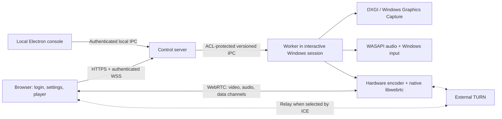

# Product requirements and architecture

## 1. Product contract

An owner installs the Windows host, completes local setup, and receives a verified URL. An authorized user opens that URL, signs in, chooses an allowed desktop or application and a quality preset, and clicks Connect. The browser shows the remote session, with optional performance metrics and input controls. Normal use must not require installing a client, Node.js, or developer tools.

Use `https://host.example` as the preferred public address; support an IP address only with an appropriate trusted certificate. `/` shows login or the user's launcher. `/admin` provides privileged host management after authentication. A stream user should not need host administration rights simply to play.

The host is a remote-control product: authentication, revocation, and capture policy are foundational requirements. A single shared admin password can bootstrap a personal installation, but production use requires individual accounts and roles.

### Supported scope and boundaries

| Area | First production scope | Later / conditional |
|---|---|---|
| Host OS | Supported Windows 11 x64 release with interactive desktop | Windows Server Desktop Experience, ARM64 after validation |
| Capture | One display or selected window | Several displays streamed concurrently |
| Sessions | One controller, one active stream | Viewers, controlled handoff, multiple independent VMs |
| Client | Certified current Chrome/Edge desktop versions | Firefox, Safari, Android, iOS through a published test matrix |
| Video | SDR, H.264 with VP8 fallback, 720p/1080p up to 60 FPS | 120 FPS, AV1, 1440p/4K, HDR after capability and latency gates |
| Input | Mouse, keyboard, touch-to-mouse | Gamepads through a maintained signed virtual device solution |
| Network | LAN, routed public host, TURN relay | Hosted reverse access gateway for hosts behind CGNAT |
| Isolation | Owner's trusted desktop | Untrusted app-only access in a dedicated locked-down VM/session |

"Any device" means a responsive launcher and capability detection, not identical gaming controls or decoding performance. If WebRTC or a required codec is unavailable, show a clear unsupported state before allocating capture resources.

## 2. Architecture decision

**Recommended target: Electron orchestration and packaging, with a native media worker.** This is a design recommendation based on the control and measurement requirements below, not a benchmark result.

The HTTPS control server and Electron host console are backend components. The downloaded web application is the frontend. Native components remain part of the backend and ship in the same installer.

### Component responsibilities

| Component | Responsibility and trust boundary |
|---|---|
| Electron console | Setup wizard, source preview, local kill switch, URLs, health, configuration and updates. Loads bundled assets only. |
| Control server | Static web assets, authentication, authorization, source catalog, session leases, signaling, ephemeral TURN credentials, audit and diagnostics. No arbitrary shell API. |
| Streaming worker | Owns capture, GPU textures, encode, WebRTC peer, audio and input. Lives in the selected interactive Windows user session. Independently enforces session grants and a local input watchdog. |
| Optional service broker | Starts and monitors the appropriate per-user worker; handles lifecycle and narrowly scoped privileged operations. Does not perform desktop capture in Session 0. |
| Browser | Capability detection, receive media, user gesture for playback and capture of local input events, controls and local statistics. Has no Electron or Node privileges. |
| TURN | External authenticated network relay. No account administration or capture policy authority. |

Windows services cannot directly interact with users in modern Windows. Microsoft documents the separate application plus IPC pattern. This supports separating the broker from the interactive worker. [Microsoft Interactive Services](https://learn.microsoft.com/en-us/windows/win32/services/interactive-services)

### Why Electron alone is not the committed gaming architecture

Electron supplies source enumeration and capture integration. It is a useful prototype and possible standard desktop tier. Its public capture APIs do not constitute a contract for choosing an arbitrary GPU encoder, zero-copy GPU transport, or a given gaming latency. A prototype must measure the actual negotiated codec, encode behavior, frame pacing and hardware use. [Electron desktopCapturer](https://www.electronjs.org/docs/latest/api/desktop-capturer)

For the native path, choose C++ and native libwebrtc with a custom capture source and encoder factory. Keep capture frames on the GPU where possible, adapt hardware encoding to libwebrtc, and let libwebrtc own RTP, feedback, congestion control, ICE, DTLS, SRTP and SCTP. This is substantial native engineering; do not assume piping an H.264 file into a browser `MediaStreamTrack` implements it. The encoder factory is an integration interface and explicitly subject to change, so pin and test the libwebrtc revision. [libwebrtc encoder factory](https://webrtc.googlesource.com/src/+/refs/heads/main/api/video_codecs/video_encoder_factory.h)

The Electron prototype uses a hidden, trusted sender renderer with Chromium WebRTC. The production native worker replaces that sender peer; do not run two competing transports for the same stream.

### PeerJS and nut.js

Use native browser `RTCPeerConnection` and a small, versioned WSS signaling protocol for the target design. PeerJS is optional for a disposable connection prototype, not another layer alongside an independent custom negotiation protocol. If retained, self-host PeerServer and place application authorization around it. A peer ID or client metadata is never an identity credential. PeerJS itself warns against using its routing ID as identity. [PeerJS API](https://peerjs.com/client/api/peer), [PeerServer](https://github.com/peers/peerjs-server)

nut.js can accelerate the first mouse/keyboard experiment. Production gaming input needs explicit relative motion, scan-code semantics, watchdogs and performance measurement. Abstract the input provider so native Windows input can replace it. Its prebuilt binaries currently require a paid subscription, and Electron native-module compatibility must be verified before adopting it. [nut.js installation](https://nutjs.dev/docs/installation)

### Alternatives considered

| Option | Assessment |
|---|---|
| Electron-only host | Fastest validation route; retain only for tiers that meet measured gates. |
| Electron + native WebRTC worker | Selected target for browser access plus explicit media control. Highest engineering and maintenance cost. |
| Sunshine + Moonlight | Benchmark and existing-product reference. Sunshine provides hardware encoding and low-latency streaming, but its browser UI is configuration/pairing; it does not by itself satisfy this browser-player requirement. |
| RDP/VNC/noVNC | Useful desktop-access alternatives; not selected as the transport for the gaming requirement. |
| HLS/DASH | Not selected because this product requires interactive input and short buffering. |
| SFU | Defer until multiple viewers justify it. Adds infrastructure without solving capture or input isolation. |

Sunshine's official documentation describes its Moonlight host, hardware encoder support and browser configuration UI. Use it as a baseline; copying or bundling code requires reviewing the exact component licenses. [Sunshine](https://docs.lizardbyte.dev/projects/sunshine/latest/), [source license](https://github.com/LizardByte/Sunshine/blob/master/LICENSE)

## 3. Required product behaviors

- **Host setup:** Local owner enrollment, supported-hardware check, TLS choice, network diagnostics, firewall instructions, source and application policy, optional TURN, verified ready state.
- **Session setup:** Login, capability check, available-source list, preset selection, server-side validation, resource reservation, negotiation progress, first-frame confirmation.
- **Player:** Fit/fill, fullscreen, sound toggle, input mode, touch controls, keyboard overlay, connection quality, disconnect and visible escape instructions.
- **Admin:** Accounts, roles, active sessions, force disconnect, allowed sources/apps, network/TURN configuration, certificate health, update status and diagnostics.
- **Host console:** Local preview, capture indicator, immediate Stop Sharing control, resource usage, selected display/capture GPU/encoder GPU, pending restart reasons.
- **Policy:** Fail closed on denied source, user revocation, lost grant, expired lease or unexpected process identity; do not silently switch to whole-desktop capture.

## 4. Proposed nonfunctional targets

Targets are provisional until Phase 0 establishes reference hardware and workload. Numbers apply only under the stated test conditions.

| Measure | Proposed release gate |
|---|---|
| LAN connect to first decoded frame | p95 <= 3 seconds after Connect; excludes login and human approval |
| Controlled WAN connect | p95 <= 8 seconds at RTT <= 40 ms, including TURN cases in separate reports |
| Gaming input-to-photon | p95 <= 80 ms on reference 1080p60 hardware, wired LAN RTT <= 5 ms; <= 120 ms on controlled RTT <= 40 ms WAN |
| Steady active-motion frame rate | At least 55 decoded FPS in 95% of 1-second windows for the 60 FPS tier; no expected static-scene frame requirement |
| Recovery | p95 <= 10 seconds after network restoration in the supported recovery matrix |
| Soak | 8-hour active test with no monotonic resource leak; memory drift <= 10% after warm-up, corroborated with handle/GPU counters |
| Security | No unauthenticated capture/input; revocation closes media and releases input within 2 seconds on a responsive host |

Report all targets with workload, browser, OS build, GPU/driver, route, bitrate, sample count and measurement method. Browser RTT is not input-to-photon latency. These gates do not guarantee competitive esports performance on arbitrary Internet paths.

## 5. Requirements traceability

| User requirement | Planned implementation | Verification |
|---|---|---|
| Open server URL | Bundled HTTPS frontend; separate reachability and trust checks | LAN/public/IPv6/certificate tests |
| Admin password | Local enrollment; individual roles; optional MFA for Internet administration | Auth, rate limit, expiry, recovery tests |
| Display/app selection | Policy-filtered source catalog, stable native identities | Hotplug, PID reuse, source disappearance |
| Fast gaming | Native GPU pipeline, bounded queues, WebRTC input | Physical latency rig and reference gameplay |
| Built-in signaling | Same-origin WSS endpoint and versioned messages | Ordering, unauthorized room, replay tests |
| One Electron package | Signed installer includes web assets, server and workers | Clean Windows VM install and offline launch |
| Ports/TURN assistance | Setup diagnostics and generated topology-specific instructions | Forced relay, blocked UDP, double NAT tests |
| Metrics | Separate capture/encode/decode/presented metrics | Counter reset and unsupported-field tests |
| Any device | Responsive UI plus honest browser capability grades | Real mobile and desktop devices |
| Allowed apps | Launch/capture policy; separate VM for isolation | Escape, focus, child-process and restart tests |
