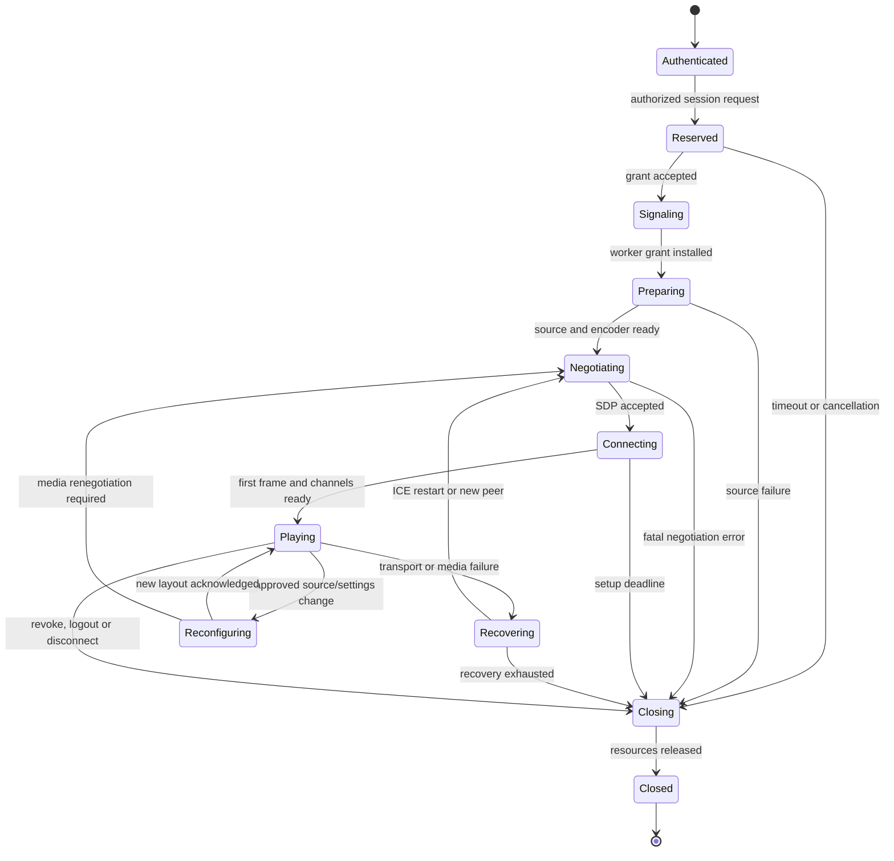

# Connection flow, APIs, and recovery protocol

The protocol below is a proposed application contract. Generate TypeScript and C++ validation from shared schemas during implementation. The browser is the initiating client; the host is the designated SDP offerer, keeping the ordinary path free of offer collisions.

## 1. End-to-end user journey

1. User opens the host URL. Show a small bundled shell with no remote source enumeration, screenshots or sensitive health data before login. Check HTTPS and required browser capabilities.
2. User signs in; server establishes a bounded, revocable authenticated session. A non-admin account lands on its permitted launcher; an admin may enter `/admin`.
3. Browser retrieves its policy-filtered capabilities and source catalog. Display sources use server-issued opaque IDs plus a catalog generation. Do not accept a client-supplied native window handle or process ID as authority.
4. Browser shows safe defaults: Auto source if uniquely allowed, 1080p60 or lower based on capability, adaptive bitrate, audio as allowed, and a visible control/view-only choice. Advanced GPU/codec settings are administrator policy, not unrestricted viewer overrides.
5. Connect is a user gesture. Request playback/fullscreen/pointer lock in the browser-supported sequence and provide a later Enable Sound button if permission is not retained through asynchronous setup. No microphone or client screen permission is needed to receive the host stream.
6. `POST /api/v1/sessions` validates identity, role, source generation, app policy, host availability, encoder capacity and requested settings. Atomically reserve the sole controller lease and return an opaque session ID and short-lived signaling grant. Capture has not yet started.
7. Browser opens same-origin WSS. Cookies authenticate the upgrade; validate Origin and send the session grant in a bounded initial message, not a URL token. No signaling or resource-intensive work until the grant is verified. Keep an initial-auth timeout.
8. Bind this socket to the authorized session and worker. The host's internal worker uses protected IPC rather than an anonymously joinable public room. If future remote workers use WSS, they need separate machine authentication.
9. Start the approved capture source after authorization, initialize encoder/audio and create the host peer. Browser creates its matching peer and receives the agreed ICE configuration. Return a specific failure if capture initialization fails.
10. Host adds video/audio send tracks and data channels; browser is receive-only for media unless a later feature explicitly adds microphone input. Negotiate BUNDLE/RTCP multiplexing through the stack.
11. Host `createOffer()` then `setLocalDescription()`, and sends the SDP offer via signaling. ICE gathering starts as part of setup; candidates may arrive while SDP messages are in transit.
12. Browser awaits `setRemoteDescription(offer)`, creates/sets its answer, and sends it. Host awaits `setRemoteDescription(answer)`. Queue received candidates until the corresponding remote description is installed, then drain serially.
13. Trickle candidate messages in both directions with negotiation revision and ICE generation identifiers. Include end-of-candidates handling. Reject stale session/generation messages; never add them to a new peer.
14. ICE checks candidate pairs; the stack establishes DTLS/SRTP and, for input, SCTP over DTLS. Prefer the best validated path selected by ICE; do not infer that all direct candidates are faster than all relays.
15. `connectionState=connected` is progress, not success. Wait for first decoded video, required audio readiness and the input channels' application-level `ready` acknowledgment. Show Playing only after actual first-frame evidence.
16. Browser begins sending input only with a current control lease and matching layout epoch. Server/worker enforce authorization independently. The player shows direct/relay transport, sound, input mode and optional metrics.
17. During play, renew bounded grants/leases, monitor media progress and input watchdog, and adapt quality without repeatedly interrupting negotiation. WSS remains available for control, source changes and recovery.
18. Disconnect, logout, revoke or local Stop Sharing releases keys/buttons/gamepads, invalidates the control lease, closes data channels and peer connections, stops tracks/audio and capture, releases GPU resources and reservations, and writes an audit event. Make this idempotent.

The original offer/answer and Trickle ICE flow is sound; the additions above establish authorization, ordering, first-frame detection and cleanup. WebRTC leaves application signaling to the application. [WebRTC peer connection guide](https://webrtc.org/getting-started/peer-connections)

## 2. Session state machine



Every active state must also accept cancel, revoke and host shutdown. These transitions are omitted from the diagram for readability. A single authoritative server state and atomic reservation prevent duplicate controllers from concurrent tabs.

### Proposed timeouts

| Operation | Initial value | On expiry |
|---|---|---|
| Unauthenticated WSS grant message | 5 seconds | Close without allocating a peer |
| Unused reservation | 15 seconds | Release reservation |
| Capture/encoder preparation | 10 seconds | Specific host error; clean resources |
| Negotiation + first frame | 20 seconds | Diagnose ICE/codec/capture independently; bounded recovery |
| Signaling heartbeat | 5-second interval, 15-second stale threshold | Reconnect and renew authorization or close |
| Worker input heartbeat | 250 ms; release pressed state after 1 second missing | Release input independently of WSS |
| Local worker grant | 15 seconds, renewed every 5 seconds while authorized | Stop input and media on expiry |
| Setup/recovery attempts | At most 3 per incident, total recovery budget 30 seconds | Stop and show actionable error |

Values need testing on backgrounded mobile tabs and slow hardware. A heartbeat pause must cause a safe pause, not silently let an expired controller keep acting. State transitions use monotonic time; credential expiry uses a trusted wall clock. Watchdog behavior must remain safe when the control server crashes.

## 3. REST API outline

| Method and path | Authorization | Contract |
|---|---|---|
| `POST /api/v1/auth/login` | Public with abuse controls | Password/MFA login; rotate cookie session |
| `POST /api/v1/auth/logout` | Authenticated + CSRF | Revoke account session and its streams |
| `GET /api/v1/me` | Authenticated | User roles and allowed actions |
| `GET /api/v1/capabilities` | Authenticated | Sanitized host/client negotiation capabilities |
| `GET /api/v1/sources` | Authorized user | Policy-filtered IDs, labels, catalog generation; thumbnails only when allowed |
| `POST /api/v1/sessions` | Stream permission + CSRF | Idempotent reservation from approved source/preset |
| `GET /api/v1/sessions/{id}` | Session owner/admin | State, selected settings, public error code |
| `POST /api/v1/sessions/{id}/signaling-grant` | Owner/admin + CSRF | Short-lived single-use WSS/resume grant |
| `POST /api/v1/sessions/{id}/ice-config` | Owner with live grant | Short-lived ICE config; strict issue limits |
| `PATCH /api/v1/sessions/{id}/settings` | Owner within policy/admin | Validate change, version-check, return applied/pending/rejected fields |
| `DELETE /api/v1/sessions/{id}` | Owner/admin + CSRF | Idempotent stop |
| `GET /api/v1/admin/diagnostics` | Admin | Redacted health; no secrets |
| `PUT /api/v1/admin/config` | Admin + recent reauthentication | Versioned config update with audit and validation |
| `POST /api/v1/admin/diagnostics/export` | Admin + CSRF | Redacted support bundle, bounded lifetime |

Public liveness returns only a minimal status. Database readiness, source lists, hostnames and machine identifiers require authentication. Changes use ETags or explicit expected configuration versions. Session creation uses a user-scoped idempotency key so a retry cannot launch two workers.

Use structured errors: `code`, `requestId`, `retryable`, safe `message`, and optional bounded remediation fields. Use 401/403/409/429 for authentication, permission, conflicts and rate limits, respectively. Never return raw native errors or stack traces to unauthenticated clients.

## 4. Signaling schema

Envelope example:

```json
{
  "v": 1,
  "type": "ice.candidate",
  "sessionId": "opaque-session-id",
  "connectionEpoch": 2,
  "negotiationRevision": 3,
  "messageId": "unique-id",
  "payload": {
    "candidate": "candidate:...",
    "sdpMid": "0",
    "sdpMLineIndex": 0,
    "usernameFragment": "ice-generation-id"
  }
}
```

Message set: `auth.bind`, `session.ready`, `session.state`, `sdp.offer`, `sdp.answer`, `ice.candidate`, `ice.complete`, `settings.request`, `settings.result`, `layout.changed`, `layout.ack`, `session.stop`, `session.error`, `ping`, `pong`, `resume.request`, `resume.result`.

Enforce protocol version, schema, message size, per-type rate and direction, session ownership, expected epoch/revision and valid state before dispatch. The server maps session IDs to authenticated endpoints; clients cannot select arbitrary destination peers. Initial proposed bounds: 128 KiB SDP/envelope, 200 queued candidates per revision, 5-second out-of-order queue deadline; tune from browser interoperability evidence. Reject unbounded candidate floods without logging SDP/candidate contents.

Use one serialized negotiation queue on each endpoint. Source switches normally use `replaceTrack` when compatible; resolution, codec or transceiver changes may need renegotiation. Only the host issues ordinary offers. If client-offer support is introduced, implement the documented perfect-negotiation pattern and test glare rather than relying on timing.

Do not replay old SDP/ICE after a WSS reconnect. Resume begins with an authoritative state snapshot and the live epoch. The server decides whether to preserve the peer, restart ICE or create a new peer. Rotate resume grants, bind to the authenticated user, and revoke an older controlling socket when accepting the replacement.

## 5. Failure and recovery behavior

| Failure | Required behavior |
|---|---|
| WSS drops but media still flows | Release control at watchdog deadline; reconnect WSS with bounded backoff; media may remain only until the worker authorization lease expires. Revalidate before restoring input. |
| ICE temporarily disconnected | Show Reconnecting, release input; allow brief recovery, then perform serialized ICE restart with fresh credentials if required. |
| ICE failed / Wi-Fi-to-cellular switch | New ICE generation; discard old candidates; restart once, then new peer within bounded budget. |
| `connected` but no frames | Compare sender capture/encode progress and receiver packet/decode progress. Diagnose capture, codec, keyframe or transport; rate-limit keyframe requests. |
| Browser refresh or duplicate tab | Old lease cannot coexist with replacement control. User resumes or explicitly takes over; never create a second controller silently. |
| Worker crash / GPU device lost | Release input via independent cleanup path; recreate worker/pipeline with new epoch; stop after crash-loop threshold. |
| Display removed / resolution or DPI changes | Pause affected input, increment layout epoch, re-enumerate, ask for approved replacement if necessary. No silent source expansion. |
| Window closes/minimizes | Pause/blank with reason; wait for valid source or stop. Do not switch to desktop capture. |
| Windows lock/UAC secure desktop/logoff | Stop input and hide stale desktop; report protected/unavailable state. No automatic unlock or elevation bypass. |
| Server reboot/sleep/resume | Old sessions invalid. Recheck capabilities/time/TLS after wake; fresh authorization and worker handshake. |
| TURN unavailable / quota exhausted | Try other configured ICE paths within policy; explain relay failure without exposing credentials. |
| Password reset / account disable / admin revoke | Invalidate grants and close worker media/input, including existing WebRTC path; closing WSS alone is insufficient. |
| Auth or policy failure | Terminal; no automated retries that bypass permissions or lockout controls. |

Cleanup must succeed even if it runs twice, if a socket has already closed, or if only some resources were created. Retain a small terminal-state record for idempotency and audit, not capture content.
